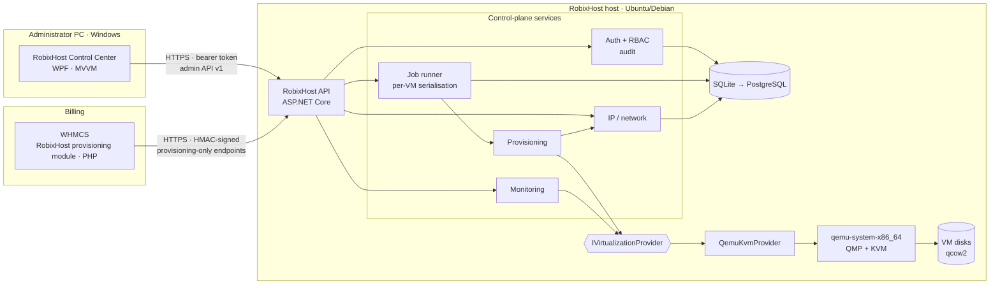
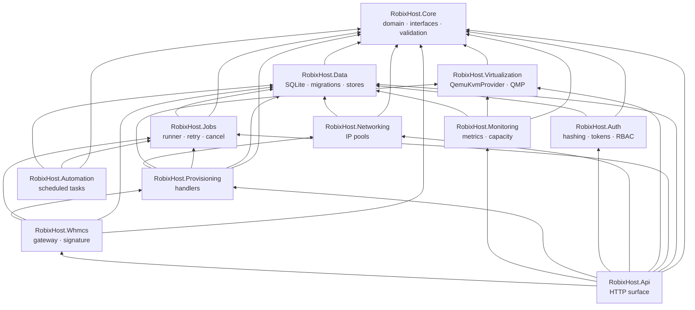

# RobixHost architecture

RobixHost is a VPS hosting control plane: its own API, database, job engine, provisioning, IP management, billing
integration and desktop application. It drives a low-level virtualization engine through a provider interface. It is
**not** a skin over another hosting panel.

> Status labels used throughout: **[verified]** = exercised by an automated test that ran, **[implemented]** = code
> exists but was not exercised end-to-end here, **[designed]** = decided and documented, not built.
> The live status of every item is in [`STATUS.md`](../STATUS.md).

## 1. Decision (ADR-001): KVM/QEMU on a dedicated Linux host, behind `IVirtualizationProvider`

### What was decided

| Layer | Choice |
|---|---|
| Hypervisor host | Dedicated **Ubuntu 22.04/24.04 or Debian 12/13** machine, x86_64, with KVM |
| Execution engine (first provider) | **Linux KVM + QEMU** (`qemu-system-x86_64`, `qemu-img`), driven directly through process control and QMP sockets by `QemuKvmProvider` |
| Control plane | RobixHost API (ASP.NET Core, .NET 8) + SQLite (dev / single node) → PostgreSQL (production, multi-node) |
| Admin UI | **RobixHost Control Center**, a Windows desktop client (WPF, .NET) that talks to the API over HTTPS |
| Billing | WHMCS provisioning module (PHP) calling a separate, HMAC-signed, provisioning-only API surface |
| Second provider | Hyper-V (Windows Server) behind the same interface **[designed]** |

KVM and QEMU are used as *execution technologies*, in the same way a web product uses the Linux kernel's TCP stack.
RobixHost owns everything the customer and the administrator see or depend on: lifecycle orchestration, capacity
rules, IP management, jobs, audit, access control, billing integration, UI and branding. Neither Proxmox, libvirt,
Virtualizor nor SolusVM is a runtime dependency.

### Why not a Windows host with the .exe as the hypervisor

A desktop `.exe` cannot be a hypervisor. Virtualization needs CPU virtualization extensions (VT-x/AMD-V), second-level
address translation, a kernel-mode component, device emulation, and a storage/network data path. On Windows the only
supported way to get those is the Windows Hypervisor Platform or Hyper-V, which are available only on specific editions
and configurations. The Control Center therefore runs on the admin's Windows PC and **manages** a host; it is not the host.

### Why not write a new bare-metal hypervisor

Doing so means writing and then maintaining: a boot path (UEFI), a VMX/SVM monitor, EPT/NPT memory virtualization, an
interrupt controller and timers, a PCI and device model (virtio, AHCI/NVMe, network, USB, VGA, TPM/UEFI for Windows),
a storage stack with snapshots, a virtual network stack, SMP scheduling, microcode/errata handling for each CPU
generation, and a security process for guest-escape vulnerabilities. This is a multi-year, multi-engineer effort per
major feature set (KVM and QEMU have thousands of contributor-years behind them), and a Windows guest is not
certifiable without that device model. It is not a reasonable scope for this product, and claiming otherwise would
be false. Revisit only if there is a concrete requirement KVM cannot meet.

### Assessment against the required criteria

| Criterion | KVM/QEMU on Linux (chosen) | Hyper-V on Windows Server | Own hypervisor |
|---|---|---|---|
| Host OS | Ubuntu/Debian, free | Windows Server (licence) | Own boot environment |
| CPU virtualization | Required (VT-x/AMD-V); detected, reported | Required; Windows-hosted | Required; all re-implemented |
| Windows guests | Supported (e1000e/IDE for installers; virtio drivers optional); **licence is the customer's/operator's** | Native, best integrated | Not feasible |
| Linux guests | Excellent (virtio, cloud images) | Good | Not feasible |
| Performance | Near-native with KVM + virtio | Near-native | Unknown |
| Security | Mature isolation; large patch cadence from distro | Mature; Microsoft cadence | Entirely our responsibility |
| Maintenance | `apt upgrade` | Windows Update + licensing | Unbounded |
| Install complexity | Moderate (documented, preflight-checked) | Moderate | Extreme |
| Licensing cost | None | Per-core Windows Server licensing | n/a |

### What the real development environment looks like (assessed, not assumed)

Measured by `host/preflight.sh` and the test suite in this workspace:

* Ubuntu 24.04, x86_64, 2 vCPU, 8 GB RAM, 30 GB free, QEMU 8.2.2, .NET SDK 8.0.132, PHP 8.3.
* **No `/dev/kvm` and no VT-x/AMD-V**: the workspace is itself a VM without nested virtualization.
* No NuGet access, so the build uses only the .NET shared framework and the system `libsqlite3` (P/Invoke).
* No Windows host or WHMCS install, so the WPF client, the installer and a real WHMCS cannot be built or run here.

Consequence: VM control is tested for real against QEMU under **TCG software emulation**
(`AllowSoftwareEmulation=true`, a flag that defaults to `false`). That proves process control, QMP handling, state
verification and cleanup. It does **not** prove KVM performance or guest-device behaviour; those require a
compatible host (see "Blocked" in `STATUS.md`).

## 2. System architecture

Trust boundaries:

1. **Admin API** (`/api/v1/*`, bearer token, role-based): reachable only from the management network/VPN.
2. **Billing API** (`/api/v1/whmcs/*`): a different authentication scheme (HMAC over timestamp + nonce + body, replay-protected),
   able to create/suspend/unsuspend/terminate a service and read job status only. It cannot read the host, list VMs or power-control arbitrary VMs.
3. **Hypervisor access** exists only inside the host process, never exposed.

## 3. Component dependency diagram (derived from the actual project references)

`RobixHost.Core` has **no** references and no I/O, so the domain can be tested in isolation. The provider interface
lives in Core; only `RobixHost.Virtualization` knows about QEMU.

## 4. Principles that are enforced in code, not only written down

| Principle | Where / how | Status |
|---|---|---|
| Never report success before the hypervisor confirms | Provider methods return only after polling the real state (QMP `query-status`, process liveness). A guest that ignores ACPI yields `vm.shutdown_timeout`, not "stopped". `ForceStop` also waits for the OS process to exit | **[verified]** |
| Database is not the source of truth for VM state | `GetAsync` derives state from the live process + QMP; an externally killed VM reads as `Stopped` | **[verified]** |
| No duplicate VMs / IPs | Job idempotency keys (`whmcs-create-<serviceId>`), idempotent handlers, IP pick-and-insert in one transaction + UNIQUE index | **[verified]** |
| Long operations are jobs | Persistent queue; retries for transient errors only; crash recovery; cancellation; structured logs; secrets redacted from stored errors | **[verified]** |
| Same-VM operations never interleave | Jobs sharing a concurrency key run one at a time in submission order | **[verified]** |
| No silent destructive operations | Terminate **retains disks**; freeing them is a separate `purge` that requires typing the VM name (enforced in the provider, audited) | **[verified]** |
| No software-emulation by accident | `provider.no_kvm` refusal unless `AllowSoftwareEmulation=true` | **[verified]** |
| Path traversal / command injection | VM names regex-validated; ISO/backing paths confined to the image root with symlink-escape checks; all external commands use argument arrays (never a shell); backing images must be a self-describing format | **[verified]** |
| Authorization on the server | Every admin endpoint calls `Require(perm)`; the billing role has no host/power permissions; denials are audited | **[verified]** (unit) |
| Secrets | Passwords hashed (PBKDF2); tokens HMAC-signed; account lockout; no admin password in logs; WHMCS secret file mode 0600 | **[verified]** |

## 5. Data model

Implemented tables (see `src/RobixHost.Data/Migrations.cs`): users, audit events, jobs + job logs, VMs (spec, desired
state, suspension, service mapping), IP pools, IP allocations (with history), WHMCS service tracking. Designed but not
yet built: customers, plans, storage pools, templates, backup jobs, alerts, roles-as-data, per-node inventory.

## 6. Multi-node (designed, not built)

Every VM, pool and job already carries a name that can be scoped by a `node` column; the provider interface is
per-node. A scheduler that places a VM by capacity and a node agent protocol are future work. No live migration, HA,
shared storage or failover is claimed anywhere in the product.
